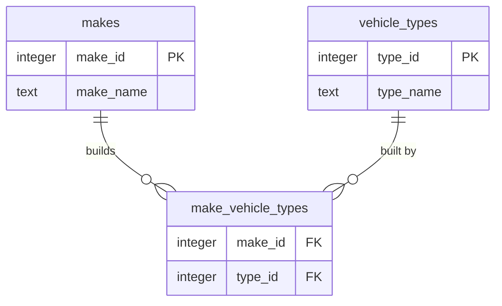

# Vehicle catalog service

Pulls vehicle makes and their vehicle types from the
[NHTSA vPIC API](https://vpic.nhtsa.dot.gov/api/) (XML), combines them into one
JSON structure, stores it in PostgreSQL and serves it through one GraphQL
endpoint.

```json
[{ "makeId": 440, "makeName": "ASTON MARTIN",
   "vehicleTypes": [{ "typeId": 2, "typeName": "Passenger Car" }] }]
```

Built with NestJS, TypeScript, GraphQL (Apollo), PostgreSQL + TypeORM, Zod and
Pino. How it works inside: [docs/design.md](docs/design.md).

## Run it

```bash
docker compose up --build
```

Starts PostgreSQL, a local NHTSA mock and the API. The catalog fills in the
background on first start: the first makes appear within seconds and
`lastIngestion` shows the progress.

- GraphQL: http://localhost:3000/graphql (opens Apollo Sandbox)
- Health: http://localhost:3000/health

Docker Compose uses the **mock** by default, so nothing calls the real API. To
use NHTSA:

```bash
NHTSA_BASE_URL=https://vpic.nhtsa.dot.gov/api/vehicles docker compose up --build
```

A full ingestion from NHTSA is ~12,400 requests and takes about 40 minutes at 5
requests per second; makes become queryable batch by batch.

## Develop

Requires Node 22, pnpm 10 and Docker.

```bash
pnpm install
cp .env.example .env       # uses the local mock
docker compose up -d db
pnpm mock:nhtsa            # mock on :8080
pnpm start:dev             # API on :3000
pnpm ingest:dev            # one ingestion run
```

| Command | |
| --- | --- |
| `pnpm test` | Unit tests |
| `pnpm test:integration` | Integration and end-to-end tests (uses Docker) |
| `pnpm lint` / `pnpm typecheck` | Static checks |
| `pnpm migration:run` | Apply migrations (after `pnpm build`) |

## Build

```bash
pnpm build                 # compiles to dist/
pnpm start:prod            # runs the API
pnpm ingest                # runs one ingestion and exits (for a scheduler)
docker build -t vehicle-catalog .
```

## Configuration

Environment variables, validated at startup. The service won't start if one is
invalid.

| Variable | Default | |
| --- | --- | --- |
| `NODE_ENV` | `development` | `development`, `test` or `production` |
| `PORT` | `3000` | |
| `LOG_LEVEL` | `info` | |
| `DB_HOST` / `DB_PORT` | `localhost` / `5432` | |
| `DB_USER` / `DB_NAME` | `postgres` / `vehicles` | |
| `DB_PASSWORD` | **required** | |
| `DB_RUN_MIGRATIONS` | `true` | Apply migrations on startup |
| `NHTSA_BASE_URL` | NHTSA's URL | Point it at the mock in development |
| `NHTSA_REQUESTS_PER_SECOND` | `5` | Rate limit |
| `NHTSA_CONCURRENCY` | `10` | Requests in flight |
| `NHTSA_TIMEOUT_MS` | `10000` | Per request |
| `NHTSA_MAX_RETRIES` | `3` | For network errors, 429 and 5xx |
| `NHTSA_RETRY_BASE_DELAY_MS` | `500` | Backoff base |
| `INGEST_ON_STARTUP` | `false` | Ingest when the API starts with an empty catalog |
| `INGEST_MAKES_LIMIT` | — | Only ingest N makes |
| `INGEST_BATCH_SIZE` | `500` | Makes per batch |

## Data model



Vehicle types are stored once and linked to makes, since thousands of makes
share them. `ingestion_runs` records each ingestion: status, counts and the
makes that failed.

## GraphQL

The documented schema is in [schema.gql](schema.gql).

| Query | |
| --- | --- |
| `makes(first, after, name, vehicleTypeId)` | Makes by name, paginated with cursors, optionally filtered |
| `make(makeId)` | One make, or `null` |
| `vehicleTypes` | All vehicle types |
| `lastIngestion` | Latest ingestion run and its progress |

```graphql
{
  makes(first: 3, name: "honda") {
    totalCount
    nodes { makeId makeName vehicleTypes { typeName } }
    pageInfo { hasNextPage endCursor }
  }
}
```

Next page: pass `endCursor` as `after`.

```graphql
{
  make(makeId: 440) { makeName vehicleTypes { typeName } }
  lastIngestion { status makesSaved makesFailed }
}
```
