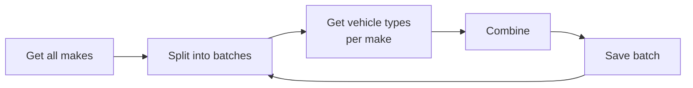

# Design

## Structure

```
src/
├── main.ts / ingest.ts   API server / one-off ingestion command
├── config/               Environment schema (Zod)
├── database/             TypeORM setup and migrations
├── graphql/              GraphQL setup and error mapping
└── modules/
    ├── vehicles/         The catalog and its queries
    └── ingestion/        Fetching and storing the catalog
```

Each module is split into `domain` (types and pure logic), `application` (use
cases), `infrastructure` (database, HTTP, XML) and `presentation` (GraphQL). The
domain doesn't depend on NestJS, TypeORM or GraphQL, so the transformation and
the pipeline are tested without a database or network.

## Ingestion pipeline



1. Fetch all makes, then process them in batches of 500.
2. For each make, fetch its vehicle types: at most 10 requests at once and 5 per
   second.
3. Combine makes with their types and save the batch in one transaction.
4. Record progress, and at the end the result: `COMPLETED`, `PARTIAL` or
   `FAILED`.

Key points:

- **Partial failures.** A make that fails is recorded and skipped; the rest
  continue. It isn't saved with an empty list, because "no vehicle types" and
  "couldn't fetch them" are different.
- **Idempotent.** NHTSA ids are the primary keys and writes are upserts, so
  running it again updates instead of duplicating.
- **One run at a time.** A Postgres advisory lock makes a second run skip.
- **Batches are saved as they finish**, so a crash keeps what was done and the
  API has data within minutes.

### NHTSA rate limits

NHTSA is behind Akamai, which blocked our IP with **403** after a few hundred
requests in bursts. So:

- requests are rate limited (`NHTSA_REQUESTS_PER_SECOND`);
- a 403 stops the run after the current batch instead of sending thousands more;
- Docker Compose and `.env.example` ingest only 50 makes by default
  (`INGEST_MAKES_LIMIT`), so trying the service costs NHTSA ~50 requests;
- a local mock ([mock/nhtsa](../mock/nhtsa)) with the real list of makes can
  replace NHTSA entirely. `NHTSA_BASE_URL` switches between mock and real.

## Error handling

| Error | Cause | Retried |
| --- | --- | --- |
| `NetworkError` | Timeout, connection error, 5xx, 429 | Yes, with exponential backoff |
| `NetworkError` | Other 4xx | No |
| `SourceBlockedError` | 403 from NHTSA | No, and the run stops |
| `XmlParseError` | Invalid XML | No |
| `TransformationError` | Valid XML with an unexpected shape | No |
| `PersistenceError` | Saving a batch failed | No; the batch is rolled back |

A failed make or batch never stops the whole run; only failing to get the list
of makes does.

In GraphQL, bad arguments return `BAD_USER_INPUT`. In production, unexpected
errors only say `Internal server error`; the details go to the logs.

## Logging

JSON logs with Pino, one object per line, with data in fields:

```json
{"level":40,"context":"IngestionService","makeId":5924,"err":{"type":"NetworkError","message":"…status 503"},"msg":"Could not fetch vehicle types for make"}
```

Logged: startup and shutdown, every request, ingestion start, progress and
summary, retries, failed makes, failed batches and unexpected errors. Errors
before the app is up (like invalid config) are logged as a JSON `fatal` line too.
Development uses a readable format.

## Configuration

- All settings are environment variables, listed in the
  [README](../README.md#configuration) and [.env.example](../.env.example).
- One Zod schema defines their types and defaults and is checked at startup.
- `NODE_ENV` picks `development`, `test` or `production`, and the service loads
  `.env.${NODE_ENV}` and then `.env`.
- `DB_PASSWORD` has no default, so production can't start without one.
